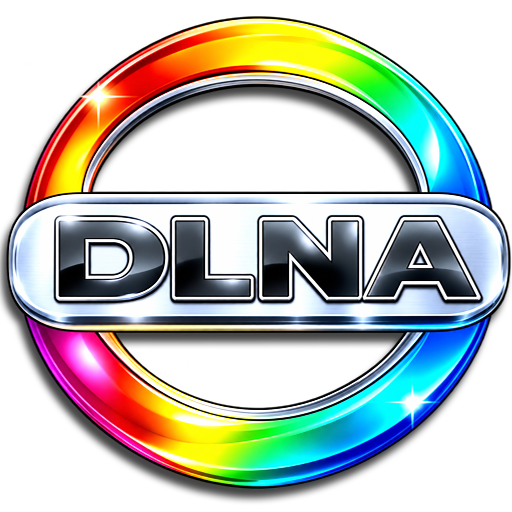
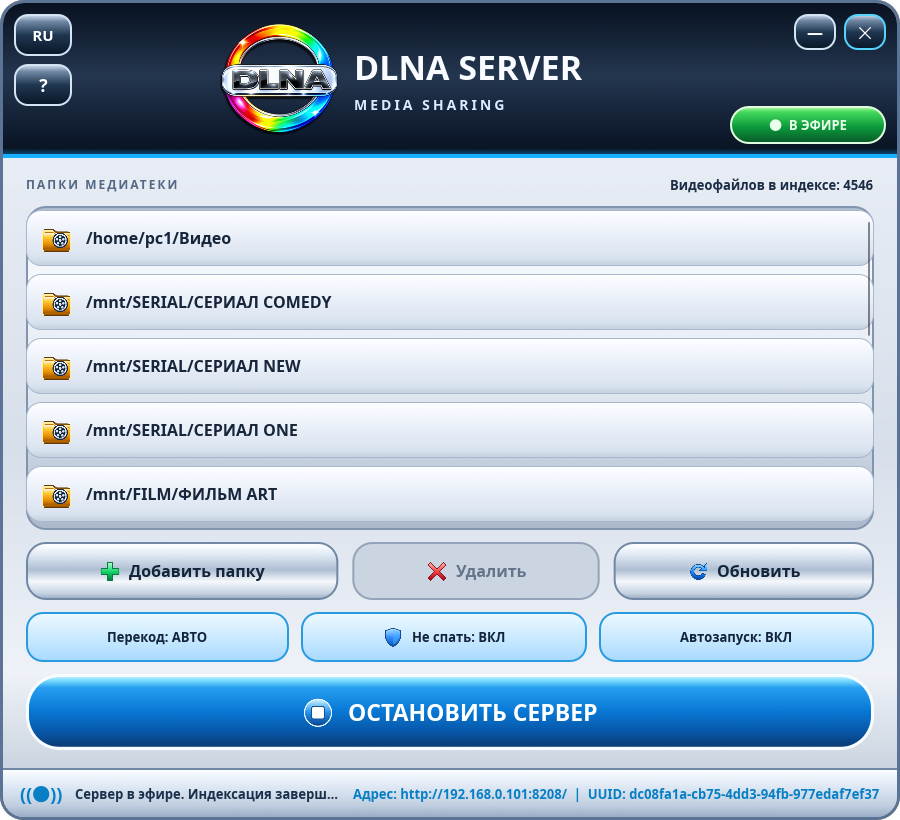

# DLNA SERVER 2.6.0

<p align="center">
  
</p>

<p align="center">
  **A lightweight, high-performance DLNA video server for Linux.**
</p>

<p align="center">
  Share your local video library with Smart TVs, mobile devices, and media players over your home network.
</p>

---

## Overview

**DLNA SERVER** is a native desktop application written in Rust for streaming local video libraries to DLNA / UPnP-compatible devices.

It is designed to provide fast library indexing, efficient network streaming, low resource consumption, and a straightforward desktop interface.

The application focuses on local video sharing. Your original video files remain untouched.



## Features

- **Automatic device discovery** — SSDP discovery and UPnP ContentDirectory integration make the server visible to compatible devices on your local network.
- **Direct Play** — streams original video files over HTTP without unnecessary transcoding.
- **HTTP Range support** — supports byte-range requests for seeking and playback control.
- **Smart transcoding** — optional conversion of unsupported formats to H.264/AAC, up to 1080p.
- **Hardware acceleration** — supports NVIDIA NVENC and VAAPI, with automatic CPU fallback when available.
- **4K protection** — includes safeguards intended to prevent excessive system load during transcoding.
- **Media library management** — add and remove shared folders, scan directories, and update the active library.
- **Automatic startup** — optional launch at system login, with network-readiness handling.
- **System tray integration** — convenient background operation.
- **Anti-Sleep protection** — uses systemd-inhibit to help prevent system suspension while serving media.
- **12 interface languages** — English, Russian, German, French, Spanish, Italian, Portuguese, Polish, Ukrainian, Chinese, Japanese, and Korean.
- **Built-in help** — an integrated guide for application features.

## Performance

The following results were measured in a direct comparison on the same Linux desktop hardware, using the same 1080p video file and local storage.

| Metric | Previous Python version | Rust 2.6.0 |
|---|---:|---:|
| CPU usage — one stream | 2.1% | **1.2%** |
| CPU usage — two simultaneous clients | — | **0.9% total** |
| Memory usage (RSS) | 141.0 MB | **137.8 MB** |
| Library scan and import | ~30 minutes | **~30 seconds** |

These are measurements from the stated test environment, not universal performance guarantees.

## Installation

### Debian / Ubuntu

Download the latest `.deb` package from the [GitHub Releases](../../releases) page and install it:

```bash
sudo apt install ./dlna-video-server_2.6.0_amd64.deb
```

Launch **DLNA SERVER** from your desktop application menu.

## Building from Source

### Requirements

- Linux
- Rust stable toolchain
- Cargo
- FFmpeg
- Development packages for Wayland, X11, Fontconfig, and FreeType
- `pkg-config`

On Ubuntu / Debian:

```bash
sudo apt install build-essential pkg-config \
  libwayland-dev libx11-dev \
  libfontconfig1-dev libfreetype6-dev ffmpeg
```

### Build

Clone the repository:

```bash
git clone https://github.com/arturzailer779-droid/dlna-server-rust.git
cd dlna-server-rust
```

Build the application:

```bash
cargo build --release -p dlna-app
```

The release binary will be located at:

```text
target/release/dlna-app
```

### Run Tests

```bash
cargo test --workspace
```

Run Clippy:

```bash
cargo clippy --workspace --all-targets
```

## Technology

- **Rust** — application and core services
- **Slint** — desktop user interface
- **SSDP / UPnP / DLNA** — device discovery and media sharing
- **HTTP** — video streaming and range requests
- **FFmpeg** — optional video transcoding
- **Tokio** — asynchronous runtime

The project is organized as a modular Rust workspace, separating the application, core logic, media library, networking, DLNA protocol, streaming, compatibility, platform integration, and transcoding components.

## License

DLNA SERVER is free and open-source software licensed under the **GNU General Public License v3.0 or later (GPL-3.0-or-later)**.

See the [LICENSE](LICENSE) file for the complete license text.

---

<p align="center">
  **DLNA SERVER 2.6.0**
  <br>
  Built with Rust.
</p>
